<picture>
  <source media="(prefers-color-scheme: dark)" srcset="docs/readme-kit/assets/hero-dark.svg">
  
</picture>

<p align="center">
  <picture>
    <source media="(prefers-color-scheme: dark)" srcset="https://readme-typing-svg.demolab.com?font=Plus+Jakarta+Sans&weight=600&size=20&duration=2800&pause=900&color=C090F5&center=true&vCenter=true&width=760&lines=A+living+archive+of+Indian+craft;A+public+site+in+front%2C+an+invisible+studio+behind;Drafts+never+leak%3A+checked+on+every+push;Served+from+Mumbai+on+Vercel">
    
  </picture>
</p>

<p align="center">
  
  
  
  
  
  <a href="https://github.com/cxacraftecosystem-ui/cxa-cms/actions/workflows/ci.yml"></a>
</p>

The public face of the **Centre of Excellence for a Unified AI-Enabled Craft Ecosystem Platform** at
IIT Kharagpur, live at **[aicraft.iitkgp.ac.in](https://aicraft.iitkgp.ac.in)**, and the CMS that
writes it. One Next.js application serves both: a cinematic, prerendered public site (research,
people, projects, publications, news, events and a craft archive), and a studio at `/studio` that no
public link points to. Every write is audited, nothing is hard-deleted by an editor, and what is live
is decided when a page is read, not when a cron last ran.

<picture>
  <source media="(prefers-color-scheme: dark)" srcset="docs/readme-kit/assets/stats-dark.svg">
  
</picture>

<picture>
  <source media="(prefers-color-scheme: dark)" srcset="docs/readme-kit/assets/divider-dark.svg">
  
</picture>

## &nbsp; What it does

<picture>
  <source media="(prefers-color-scheme: dark)" srcset="docs/readme-kit/assets/cards-dark.svg">
  
</picture>

| Surface | Route | What it is |
|---|---|---|
| **Public site** | `/` and `app/(site)/**` | Research areas, people, projects, publications, news, events, the craft explorer and India map, the gallery, the A–Z index, site search, feeds and the newsletter sign-up. Prerendered and revalidated. |
| **Studio** | `/studio` and `app/studio/**` | Pages and their sections, every content type, the media library and files, navigation, redirects, page templates, announcements, inquiries, subscribers and newsletter issues, users and the studio access list, the audit trail, the recycle bin, analytics and health. |
| **Preview** | `/preview/[[...slug]]` | A page as it will look before publication, inside the real site layout, gated by an HMAC of its slug so the link can be forwarded. |
| **Syndication** | `/news/feed.xml`, `/news/atom.xml`, `/events/calendar.ics` | RSS 2.0, Atom 1.0 and iCalendar, from published records only. |

### The content model

A `Page` owns routing, SEO and its publication state; its `PageSection` rows are ordered, typed
blocks whose payload is JSON validated by a Zod schema. A new kind of block is a new `SectionType`
value, a schema, a renderer and an editor form, never a migration. The block catalogue runs from
`HERO`, `RICH_TEXT` and `GALLERY` through the scroll-scrubbed narrative blocks (`STORY_SCROLL`,
`PARALLAX_BANNER`, `HORIZONTAL_RAIL`, `PROCESS_STEPS`) to `PLATFORM_PILLARS`, `INDIA_MAP` and
`DOCUMENT_EMBED`; `PageTemplate` rows let an administrator save and reuse an arrangement without a
deploy. Everything that is queried, filtered and cited is a first-class table.

```mermaid
%%{init: {"theme":"base","themeVariables":{"fontFamily":"Inter, ui-sans-serif, system-ui, -apple-system, Segoe UI, Roboto, Helvetica, Arial, sans-serif","fontSize":"15px","primaryColor":"#F2E9FE","primaryTextColor":"#1E1B2E","primaryBorderColor":"#9148D2","secondaryColor":"#FAEECD","secondaryTextColor":"#1E1B2E","secondaryBorderColor":"#CD9200","tertiaryColor":"#F3F1FA","tertiaryTextColor":"#1E1B2E","tertiaryBorderColor":"#A7A3BC","mainBkg":"#F2E9FE","nodeBorder":"#9148D2","nodeTextColor":"#1E1B2E","lineColor":"#AA69E9","textColor":"#857F9E","edgeLabelBackground":"#F9F5FF","clusterBkg":"#F9F5FF","clusterBorder":"#D6B6FB","titleColor":"#762CB1","noteBkgColor":"#FAEECD","noteTextColor":"#1E1B2E","noteBorderColor":"#CD9200","actorBkg":"#F2E9FE","actorBorder":"#9148D2","actorTextColor":"#1E1B2E","actorLineColor":"#AA69E9","signalColor":"#AA69E9","signalTextColor":"#857F9E","labelBoxBkgColor":"#F2E9FE","labelBoxBorderColor":"#9148D2","labelTextColor":"#1E1B2E","loopTextColor":"#857F9E","activationBkgColor":"#E7D5FE","activationBorderColor":"#9148D2","sequenceNumberColor":"#FFFFFF","transitionColor":"#AA69E9","transitionLabelColor":"#857F9E","stateLabelColor":"#1E1B2E","stateBkg":"#F2E9FE","compositeBackground":"#F9F5FF","compositeTitleBackground":"#F2E9FE","attributeBackgroundColorOdd":"#FFFFFF","attributeBackgroundColorEven":"#F9F5FF","relationColor":"#AA69E9","relationLabelBackground":"#F9F5FF","relationLabelColor":"#1E1B2E"}}}%%
erDiagram
  PAGE ||--o{ PAGE_SECTION : "ordered blocks"
  PERSON ||--o{ PROJECT_MEMBER : "serves on"
  PROJECT ||--o{ PROJECT_MEMBER : "team"
  PUBLICATION ||--o{ PUBLICATION_AUTHOR : "authors"
  PERSON ||--o{ PUBLICATION_AUTHOR : "writes"
  CRAFT_REGION ||--o{ CRAFT : "home of"
  MEDIA_ASSET ||--o{ MEDIA_VARIANT : "derivatives"
  FILE_ASSET ||--o{ FILE_VERSION : "versions"
  USER ||--o{ AUDIT_LOG : "acts"
  USER ||--o{ REVISION : "saves"
  PAGE {
    string slug
    enum status
    datetime publishAt
    datetime unpublishAt
  }
  PAGE_SECTION {
    enum type
    json data
    int position
  }
```

The schema has tables for identity and the trail (`User`, `StudioAccess`, `Session`, `AuditLog`,
`Revision`, `ContentLock`), pages, media and files, the research graph (`Person`, `ResearchArea`,
`Project`, `Publication`), news and events (`Post`, `CoeEvent`, `EventRegistration`), the craft
archive (`CraftRegion`, `CraftSchool`, `Craft`), engagement (`ContactSubmission`, `Announcement`,
`NewsletterSubscriber`, `NewsletterIssue`, `NewsletterDelivery`) and search, redirects, navigation,
settings and analytics. Every table is described in [docs/DATA-MODEL.md](docs/DATA-MODEL.md).

<picture>
  <source media="(prefers-color-scheme: dark)" srcset="docs/readme-kit/assets/divider-dark.svg">
  
</picture>

## &nbsp; How it works

<picture>
  <source media="(prefers-color-scheme: dark)" srcset="docs/readme-kit/assets/pipeline-dark.svg">
  
</picture>

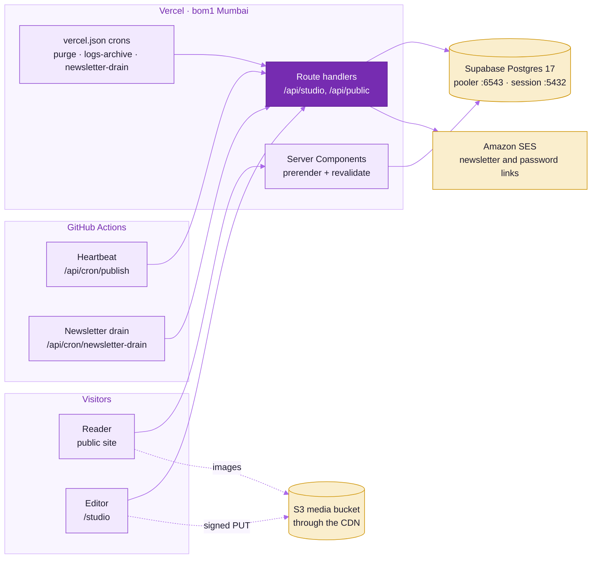

The two dotted arrows carry the bytes: a reader's image resolves to `NEXT_PUBLIC_CDN_URL` plus the
object key, and an editor's upload is a signed `PUT` straight at the bucket. That is what makes a
200 MB video upload possible inside a serverless function, and why the bucket's CORS policy decides
whether uploads work ([docs/OPERATIONS.md](docs/OPERATIONS.md) §1).

### Three invariants

| Invariant | Where it is enforced | Why |
|---|---|---|
| **Soft delete everywhere** | Every read path filters through `livePublishableWhere()` and `liveStatusWhere()` in `lib/content.ts` | An editor's delete goes to the recycle bin and can be restored. Only the nightly purge removes media past its 30-day window, and a master administrator's permanent account delete keeps a tombstone so every credit survives. |
| **Audited mutation** | `lib/audit.ts` writes the row, its revision and the audit entry in one transaction | A log that can exist without its change cannot be trusted during an incident. |
| **Publication resolved at read time** | The same filters compare `publishAt` and `unpublishAt` with the clock | The publish cron only tidies the status column. A stalled cron cannot leave an expired embargo readable or hold back a page that is due. |

### Publishing lifecycle

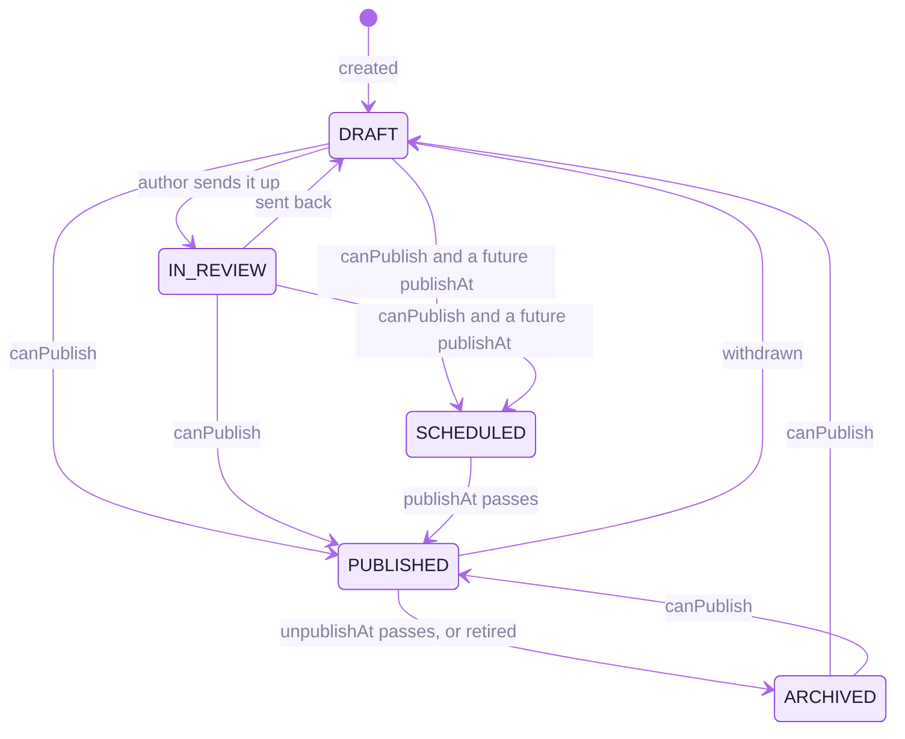

Authors draft and cannot publish; editors publish anything; a researcher publishes their own research,
projects and publications. Going public is refused while a visible block still holds one of the
studio's own prompts, and the refusal quotes the words. A draft autosaves about four seconds after the
last keystroke; a published page does not, because Save goes straight to the live site, so a block
added to a live page is created hidden until the editor turns it on. The full lifecycle, the editing
loop and where the publish cron really runs are in [docs/ARCHITECTURE.md](docs/ARCHITECTURE.md) §3.

### Media

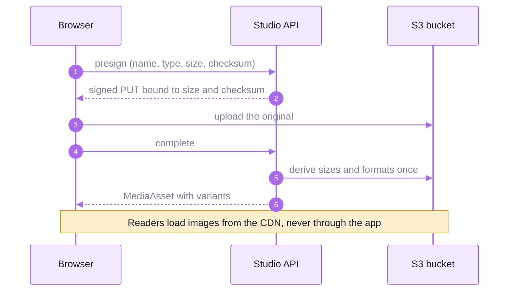

Uploads must declare their size and checksum before they are signed (October 2026 hardening), every
picture can be framed separately for phone, tablet and desktop, and openly licensed craft photography
in `public/craft/` always renders with its credit (`components/site/CraftPhoto.tsx`).

<picture>
  <source media="(prefers-color-scheme: dark)" srcset="docs/readme-kit/assets/divider-dark.svg">
  
</picture>

## &nbsp; Access and security

Two questions, kept apart on purpose:

| | Question | Answered by |
|---|---|---|
| **Authentication** | Who is this? | a password, or Google, Microsoft or Yahoo |
| **Authorisation** | Should they be here? | the **studio access list**, kept by the master administrator |

No session is issued and no account is created until the address is on the access list, whichever
method was used. Any address works, including a personal one.

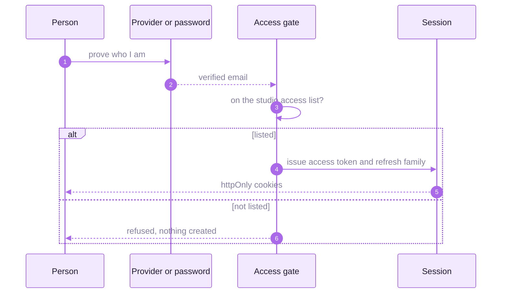

| Role | Rank | May |
|---|---:|---|
| `VIEWER` | 10 | read the studio, change nothing |
| `AUTHOR` | 20 | draft their own content, not publish |
| `MEDIA_MANAGER` | 30 | the media library and files, plus author |
| `RESEARCHER` | 40 | research, projects and publications; publish their own |
| `EDITOR` | 50 | publish anything, edit anyone's content |
| `ADMINISTRATOR` | 60 | users, settings, navigation, restore and purge |
| `MASTER_ADMIN` | 70 | who may enter the studio at all, the provenance console, permanent account deletion |

The master administrator sits above the administrator so the account used every day, and so most
likely to be phished, cannot widen the circle of people who can sign in. `canPublish` and
`canManageMedia` widen a role for one person and never narrow it.

| Protection | What it does |
|---|---|
| Sessions | A short-lived signed access token and a rotating, single-use refresh token family in the database; a reused refresh token ends the family |
| Two-step sign-in | Optional TOTP (RFC 6238) with a QR code at setup; password links are sent through SES |
| Signing key | The app refuses to start on a missing, short or placeholder `JWT_SECRET` |
| Links | `//` and `/\` are external links, not internal ones; every href is checked before render and save |
| Uploads | Presigned only with a declared size and checksum |
| Rate limits | Keyed on the real client address, not a spoofable `X-Forwarded-For` |
| Cron | Secrets only in the `Authorization` header, never in a URL |
| Audit privacy | Real email addresses and IP addresses are kept and shown to those allowed to see the trail ([docs/AUDIT-PRIVACY.md](docs/AUDIT-PRIVACY.md)) |
| Database | Supabase is used only as Postgres; Row Level Security is on for every table with no policies, and `anon` and `authenticated` hold no privileges, so the Data API answers nothing |
| Headers | HSTS with `includeSubDomains`, a CSP that forbids `object-src` and foreign frame ancestors, a strict referrer policy |

Provider setup, two-step sign-in and lock-out recovery: [docs/SIGN-IN.md](docs/SIGN-IN.md). The
October 2026 hardening, finding by finding: [docs/security/2026-10-hardening.md](docs/security/2026-10-hardening.md).

### Reaching the studio

There is no "Admin" button anywhere. Four doors, all equivalent: navigate to `/studio`; navigate to
`/console`; press <kbd>Ctrl</kbd>+<kbd>Shift</kbd>+<kbd>A</kbd> on any public page; or click the
footer wordmark seven times.

<picture>
  <source media="(prefers-color-scheme: dark)" srcset="docs/readme-kit/assets/divider-dark.svg">
  
</picture>

## &nbsp; Built with

<p align="center">
  <picture>
    <source media="(prefers-color-scheme: dark)" srcset="https://skillicons.dev/icons?i=nextjs,react,ts,tailwind,threejs,prisma,postgres,supabase,aws,vercel,docker,githubactions&theme=dark&perline=12">
    
  </picture>
</p>

| Layer | What runs |
|---|---|
| Runtime | Node 26 LTS (`engines.node` `26.x`, Vercel and CI alike), npm 12 under an `allowScripts` policy |
| Web | Next.js 16 App Router with React 19 Server Components, TypeScript 7 for `tsc` (the TypeScript 6 API for the tools that need one), ESLint 10, Tailwind 4 configured in CSS |
| Motion | framer-motion, GSAP, Lenis, React Three Fiber for the 3D surfaces, MapLibre for maps |
| Editing | Tiptap 3 rich text, dnd-kit for ordering |
| Data | Prisma 7 through the node-postgres adapter, Postgres 17 on Supabase (`ap-south-1`) |
| Storage and mail | S3 with presigned uploads, Amazon SES for the newsletter and password links |
| Hosting | Vercel functions in `bom1` (Mumbai), or one long-lived container from the `Dockerfile` |

<picture>
  <source media="(prefers-color-scheme: dark)" srcset="docs/readme-kit/assets/divider-dark.svg">
  
</picture>

## &nbsp; Quick start

### With Docker

Nothing on the host but Docker:

```bash
docker compose up -d --build
```

| Service | Where | What |
|---|---|---|
| **app** | http://localhost:3000 | the site; the studio is at `/studio` |
| **postgres** | `localhost:55432` | `postgres:17-alpine`, production's major |
| **minio** | http://localhost:9001 | silo, the maintained MinIO fork; console `minioadmin` / `minioadmin` |
| *migrate* | one-shot | applies migrations and seeds, then exits; `app` waits for it |
| *minio-init* | one-shot | creates the `cxa-media` bucket and its read policy, then exits |

Sign in at http://localhost:3000/studio with `admin@cxa.local` / `docker-development-administrator`.
The credentials in `docker-compose.yml` are development-only.

```bash
docker compose logs -f app     # watch the server
docker compose down            # stop, keep the data
docker compose down -v         # stop and delete the data
```

> [!WARNING]
> - **A `postgres-data` volume from before October 2026 will not start.** It holds a PostgreSQL 16
>   cluster and the image is now `postgres:17-alpine`. Run `docker compose down -v` once (after a
>   `pg_dump` if the data matters); `up -d --build` re-seeds.
> - **After a schema change, rebuild both images.** `app` and `migrate` each carry their own Prisma
>   client; `docker compose build app` alone leaves the migrator stale. Use `docker compose build` or
>   `up -d --build`.
> - **`NEXT_PUBLIC_*` values are inlined at build time**, so a change needs `--build`. MinIO has two
>   addresses on purpose: the server uses `minio:9000`, the browser `localhost:9000`.

### Without Docker

```bash
cp .env.example .env      # then fill it in, see Configuration below
npm install -g npm@12     # once: allowScripts is an npm 12 feature
npm install
npx prisma migrate dev    # creates the schema
npm run seed              # structural pages, settings and one administrator
npm run dev
```

```bash
openssl rand -base64 48   # a real JWT_SECRET; the app refuses to start on a weak one
```

```bash
ADMIN_PASSWORD='…' node scripts/dev/grant-master-admin.mjs someone@example.com "Their Name"
node scripts/dev/grant-master-admin.mjs someone@example.com
```

The first line creates or promotes a master administrator, storing the password only as a bcrypt
hash; the second makes a provider-only account with no password.

### Configuration

Every variable is described in [`.env.example`](.env.example). The four a deployment must set:

| Variable | Why |
|---|---|
| `DATABASE_URL` | The runtime client. In production, Supabase's transaction pooler on port 6543 with `pgbouncer=true&connection_limit=10&pool_timeout=30&sslmode=require` ([docs/DEPLOYMENT.md](docs/DEPLOYMENT.md) §1.4). |
| `DIRECT_DATABASE_URL` | Migrations and seeding; a transaction pooler cannot run them. On Supabase, the session pooler on port 5432. |
| `JWT_SECRET` | Session signing, at least 32 characters of real entropy. |
| `NEXT_PUBLIC_SITE_URL` | Canonical URLs, Open Graph and `sitemap.xml`. Without it production publishes links to `localhost` while every signal stays green. |

Object storage (`S3_*`) is optional for the public pages locally: the studio's diagnostics panel says
uploads are off. It is required the moment anybody uploads anything.

### Scripts

| Command | What it does |
|---|---|
| `npm run dev` | Development server |
| `npm run build` | `prisma generate`, then a production build |
| `npm run check` | Typecheck, lint, `route-check` and eight static checks: media selection, screens, media rendering, framing selection, video, fonts, theme and the site URL. Run before every commit. |
| `npm test` | The Node test runner over `tests/**` (newsletter, security, storage, query counts); the `*.db.test.ts` files need a migrated database |
| `npm run smoke -- http://127.0.0.1:3000` | Drives the real HTTP surface signed in: every screen, every studio endpoint, a refusal and a full content lifecycle |
| `npm run leak-check -- http://127.0.0.1:3000` | Proves no draft or deleted record is reachable from the public site |
| `npm run seed` | Structural pages, settings and the first administrator |
| `npx tsx prisma/seed.ts --with-corpus` | Adds the demonstration corpus and rebuilds the search index. Opt-in by name. |
| `npx tsx prisma/seed.ts --purge-corpus` | Removes the demonstration corpus again, by slug |
| `npx tsx prisma/seed.ts --replace-pages` | Re-applies the seeded page content over existing pages; refuses under `NODE_ENV=production` |
| `npx tsx scripts/fetch-craft-imagery.ts` | Re-fetches the bundled craft photography from Wikimedia Commons and regenerates its licence manifest |
| `node scripts/dev/shoot.mjs <url> <out.png> [w] [h] [selector\|--print]` | Screenshots the running site over the DevTools protocol |

<picture>
  <source media="(prefers-color-scheme: dark)" srcset="docs/readme-kit/assets/divider-dark.svg">
  
</picture>

## &nbsp; Verification

Four layers, each covering a blind spot of the one above it. Every layer has found a real bug here.

| Layer | Proves | Blind to |
|---|---|---|
| Typecheck and lint | the code is internally consistent | a `fetch` path is a string; it cannot know the route exists |
| `route-check` and `npm test` | every `/api/...` literal resolves to a handler exporting that method; the newsletter, security, storage and query-count tests hold | whether the handler works, and page routes addressed by string |
| `smoke` | signed in, every screen and endpoint answers; a refusal is 403, not 500; a missing record is 404, not a soft 404; create, publish and delete work end to end | content that is present but should not be |
| `leak-check` | nothing unpublished or deleted is reachable from any public surface, social cards included | the studio, which it never signs in to |

```mermaid
%%{init: {"theme":"base","themeVariables":{"fontFamily":"Inter, ui-sans-serif, system-ui, -apple-system, Segoe UI, Roboto, Helvetica, Arial, sans-serif","fontSize":"15px","primaryColor":"#F2E9FE","primaryTextColor":"#1E1B2E","primaryBorderColor":"#9148D2","secondaryColor":"#FAEECD","secondaryTextColor":"#1E1B2E","secondaryBorderColor":"#CD9200","tertiaryColor":"#F3F1FA","tertiaryTextColor":"#1E1B2E","tertiaryBorderColor":"#A7A3BC","mainBkg":"#F2E9FE","nodeBorder":"#9148D2","nodeTextColor":"#1E1B2E","lineColor":"#AA69E9","textColor":"#857F9E","edgeLabelBackground":"#F9F5FF","clusterBkg":"#F9F5FF","clusterBorder":"#D6B6FB","titleColor":"#762CB1","noteBkgColor":"#FAEECD","noteTextColor":"#1E1B2E","noteBorderColor":"#CD9200","actorBkg":"#F2E9FE","actorBorder":"#9148D2","actorTextColor":"#1E1B2E","actorLineColor":"#AA69E9","signalColor":"#AA69E9","signalTextColor":"#857F9E","labelBoxBkgColor":"#F2E9FE","labelBoxBorderColor":"#9148D2","labelTextColor":"#1E1B2E","loopTextColor":"#857F9E","activationBkgColor":"#E7D5FE","activationBorderColor":"#9148D2","sequenceNumberColor":"#FFFFFF","transitionColor":"#AA69E9","transitionLabelColor":"#857F9E","stateLabelColor":"#1E1B2E","stateBkg":"#F2E9FE","compositeBackground":"#F9F5FF","compositeTitleBackground":"#F2E9FE","attributeBackgroundColorOdd":"#FFFFFF","attributeBackgroundColorEven":"#F9F5FF","relationColor":"#AA69E9","relationLabelBackground":"#F9F5FF","relationLabelColor":"#1E1B2E"}}}%%
flowchart LR
  P([push or pull request]) --> T["Typecheck · lint<br/>route-check"]
  T --> M["Migrate · seed<br/>npm test"]
  M --> B["Build · start"]
  B --> S["smoke"]
  S --> L["leak-check"]
  L --> G{{"green"}}
  G -->|main| V["Vercel production<br/>bom1"]
  classDef accent fill:#762CB1,stroke:#5F1C93,color:#FFFFFF
  classDef gold fill:#FAEECD,stroke:#CD9200,color:#1E1B2E
  class L accent
  class V gold
```

`.github/workflows/ci.yml` runs typecheck, lint, `route-check`, migrate, seed, `npm test`, build,
`smoke` and `leak-check` against a `postgres:17-alpine` service on every pull request and every push
to `main`, with object storage deliberately unset to prove the app runs without it. The eight further
static checks in `npm run check` (media selection, screens, media rendering, framing selection, video,
fonts, theme and the site URL) are not in CI, so run `npm run check` before every commit.
`readme-check.yml` checks this README and every document under `docs/` (generated assets, SVG safety,
image references, mermaid rendering and GitHub's own Markdown render).

The smoke run exists because typecheck, lint and `route-check` were all green while twenty-odd studio
routes were unreachable. The leak check exists because a draft on the public site is an omission
across about ninety queries, which review misses. It creates a draft and a soft-deleted record of every
content type with a marker in every field, fetches every public URL, and fails if the marker appears
anywhere. Neither may ever be made `continue-on-error`.

<picture>
  <source media="(prefers-color-scheme: dark)" srcset="docs/readme-kit/assets/divider-dark.svg">
  
</picture>

## &nbsp; Operations

| Job | Schedule | Runs on | What it does |
|---|---|---|---|
| `/api/cron/purge` | 03:17 UTC daily | Vercel cron | deletes recycle-bin media past `MEDIA_PURGE_AFTER_DAYS` (30 by default), bytes first and the row second, and prunes expired sessions |
| `/api/cron/logs-archive` | 03:41 UTC daily | Vercel cron | copies each day's logs to the bucket, kept at least 90 days as the CIC hosting undertaking requires |
| `/api/cron/newsletter-drain` | 03:53 UTC daily, and every 5 minutes requested | Vercel cron and `newsletter-drain.yml` | sends queued newsletter mail through SES |
| `/api/cron/publish` | every 5 minutes requested | `keep-warm.yml` (Heartbeat) | moves due pages to `PUBLISHED` and expired ones to `ARCHIVED`, and re-syncs search |
| Erase an account | by hand | `ops-erase-account.yml` | a master administrator's permanent delete: `check` counts only, `erase` needs the address typed twice |

GitHub runs a five-minute schedule hours apart in practice, which is why publication is resolved at
read time and the cron only tidies the status column ([docs/OUTSTANDING.md](docs/OUTSTANDING.md)).

| Where | What |
|---|---|
| Production | Vercel, functions in `bom1` (Mumbai), `main` deploys; docs-only pushes are skipped by `ignoreCommand` in `vercel.json` |
| Database | Supabase Postgres 17 in `ap-south-1`, transaction pooler at run time, session pooler for migrations, which `vercel.json`'s build runs on production deploys only |
| Mail | Amazon SES on the verified `aicraft.iitkgp.ac.in` domain |
| Alternative | One long-lived container (`Dockerfile`, `output: "standalone"` in the container build only) behind a reverse proxy |

<picture>
  <source media="(prefers-color-scheme: dark)" srcset="docs/readme-kit/assets/divider-dark.svg">
  
</picture>

## &nbsp; Documentation

| Question | Read |
|---|---|
| What are the design rules, tokens, motion and traps for UI work? | [docs/CONTRACT.md](docs/CONTRACT.md) |
| How does the system fit together? | [docs/ARCHITECTURE.md](docs/ARCHITECTURE.md) |
| What happens on a page request, a studio save and an upload? | [docs/REQUEST-LIFECYCLE.md](docs/REQUEST-LIFECYCLE.md) |
| What is stored, and why is it shaped that way? | [docs/DATA-MODEL.md](docs/DATA-MODEL.md) |
| Who can sign in, and how is a provider set up? | [docs/SIGN-IN.md](docs/SIGN-IN.md) |
| How do I deploy to Vercel or a server? | [docs/DEPLOYMENT.md](docs/DEPLOYMENT.md) |
| Storage CORS, cron, backups, log drains, deleting an account | [docs/OPERATIONS.md](docs/OPERATIONS.md) |
| What does the audit log keep, and who sees it? | [docs/AUDIT-PRIVACY.md](docs/AUDIT-PRIVACY.md) |
| What was fixed in the October 2026 hardening? | [docs/security/2026-10-hardening.md](docs/security/2026-10-hardening.md) |
| What went wrong before, and what is still open? | [docs/OUTSTANDING.md](docs/OUTSTANDING.md) |
| How is this README built? | [docs/readme-kit/README_STYLE.md](docs/readme-kit/README_STYLE.md) |

### The demonstration corpus

A fresh install has three pages and no content, which is correct and unusable. `npx tsx prisma/seed.ts
--with-corpus` writes a coherent body of content about real Indian craft traditions, cross-referenced
as an archive would be: 58 regions in a three-deep tree, 42 crafts, 6 research areas, 24 people,
14 projects, 30 publications, 18 articles, 13 events and 13 partners. It is opt-in by name, and
`--purge-corpus` takes it out again. No real researcher, artisan or public figure is named, no real DOI,
ISBN or grant number appears, and no invented person is shown with a photograph of a real one.

### Craft photography and attribution

`public/craft/` holds openly licensed photographs fetched and re-encoded by
`scripts/fetch-craft-imagery.ts`, with `lib/media/craft-imagery.ts` carrying each one's photographer,
licence and source. `components/site/CraftPhoto.tsx` renders `components/site/ImageCredit.tsx`
unconditionally, and `/credits` lists every one. Use `CraftPhoto`, not `next/image`, for anything in
that manifest.

### Accessibility

Theme, reduced motion, larger text and high contrast are viewer preferences applied to `<html>` before
first paint. Reduced motion is honoured in CSS and in every framer-motion animation, colour never
carries meaning alone, and any signal that exists only as motion has a static counterpart. The
statement is at `/accessibility`.

<picture>
  <source media="(prefers-color-scheme: dark)" srcset="docs/readme-kit/assets/divider-dark.svg">
  
</picture>

## &nbsp; Status

<picture>
  <source media="(prefers-color-scheme: dark)" srcset="docs/readme-kit/assets/timeline-dark.svg">
  
</picture>

| Date | Change |
|---|---|
| 16 Aug 2026 | First release: the site, the studio, typed sections and the media pipeline |
| 17 Aug 2026 | Pictures framed per screen size, end to end |
| 16 Sep 2026 | Access logs kept for the institute, and guarded |
| 9 Oct 2026 | Next 16.4, ESLint 10, TypeScript 7; functions moved to Mumbai; previews get their own origin |
| 10 Oct 2026 | Newsletter through SES; five security gaps closed; Prisma 7.10, Zod 4, Tailwind 4; npm 12 |
| 11 Oct 2026 | Two-step setup by QR code; password links by email |
| 14 Oct 2026 | Supabase Data API locked down: RLS on every table, `anon` revoked |
| 16 Oct 2026 | SES domain `aicraft.iitkgp.ac.in` verified |
| 22 Oct 2026 | Batched per-row writes and studio filters pushed into SQL, pinned by query-count tests |
| 1 Nov 2026 | Node 26 LTS and the latest stable dependencies; a master administrator can delete an account permanently |

Production runs `main` at the head of this history. Open items and known limits are in
[docs/OUTSTANDING.md](docs/OUTSTANDING.md).

## How this document is kept true

| Claim | Kept true by |
|---|---|
| The images | `docs/readme-kit/kit.json`, regenerated by `node docs/readme-kit/tools/build.mjs`; `readme-check.yml` fails if `assets/` drifts |
| The diagrams | `readme-check.yml` renders every mermaid block here and in `docs/` with mermaid-cli |
| Roles and ranks | `enum Role` in `prisma/schema.prisma` and the ranks in `lib/permissions.ts` |
| Scripts and checks | `package.json` `scripts` and `.github/workflows/ci.yml` |
| Cron schedules | `vercel.json` `crons`, `keep-warm.yml` and `newsletter-drain.yml` |
| Versions | `package.json` (`engines.node`, dependencies) and `docker-compose.yml` |
| Status | `git log --first-parent main`; change it with each merge to `main` |

<picture>
  <source media="(prefers-color-scheme: dark)" srcset="docs/readme-kit/assets/footer-dark.svg">
  
</picture>
